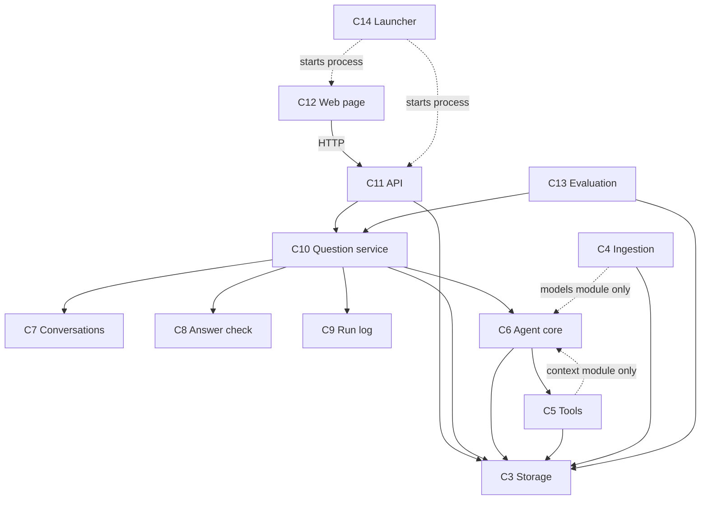
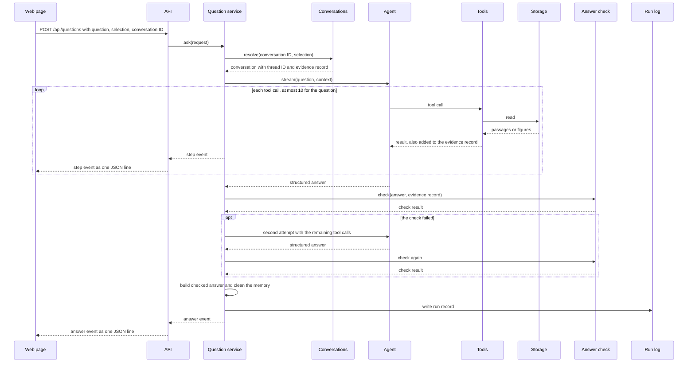
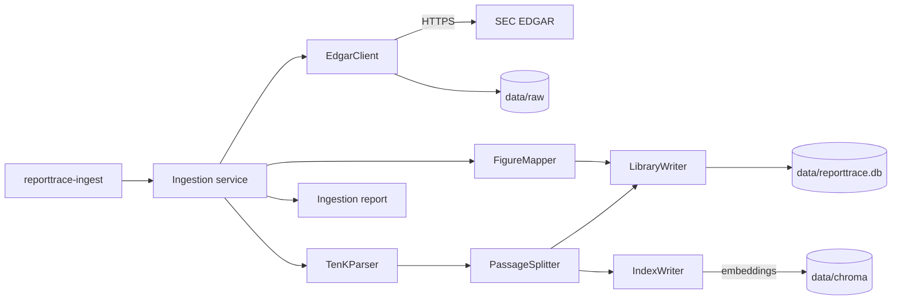

# Component Dependencies: ReportTrace

## 1. Dependency Rules

- Layers go one way: `ui` to `api` to `agent` to `tools` to `storage` (`tech-env.md`). A layer may also use any layer below the next one; for example, the API reads `storage` directly to return evidence, as in the `tech-env.md` example.
- Every component may use C1 domain types and C2 settings.
- **Three narrow exceptions**, each required by a `tech-env.md` rule:

| From | To | Why | Limit |
| --- | --- | --- | --- |
| C5 tools | C6 `agent.context` | Tools read `AgentContext` through `ToolRuntime`, as in the `tech-env.md` example | `agent/context.py` is a leaf module that imports only C1 and C3 types. Tools import nothing else from `agent` |
| C4 ingestion | C6 `agent.models` | Only `agent/models.py` may create the embedding model, and ingestion must embed the passages | Ingestion imports only `build_embeddings` |
| C12 web page | C11 `api.schemas` | The page and the API share one definition of the request, response, and event types | The page imports only `api.schemas`, never routers, agent, tools, or storage, and talks to the backend over HTTP only |

- No component imports `storage/writers.py` except C4 ingestion, so the backend cannot write to the library (NFR-3.7). A test checks the imports.

## 2. Dependency Matrix

Read each row as "the row component depends on the column component". Legend:
- **D**: direct dependency;
- **x**: allowed exception from Section 1;
- **H**: over HTTP only;
- **P**: starts the component as a process, with no import;
- **-**: no dependency.

| Component | C1 | C2 | C3 | C4 | C5 | C6 | C7 | C8 | C9 | C10 | C11 | C12 |
| --- | --- | --- | --- | --- | --- | --- | --- | --- | --- | --- | --- | --- |
| C1 Domain | - | - | - | - | - | - | - | - | - | - | - | - |
| C2 Settings | - | - | - | - | - | - | - | - | - | - | - | - |
| C3 Storage | D | - | - | - | - | - | - | - | - | - | - | - |
| C4 Ingestion | D | D | D | - | - | x | - | - | - | - | - | - |
| C5 Tools | D | - | D | - | - | x | - | - | - | - | - | - |
| C6 Agent core | D | D | D | - | D | - | - | - | - | - | - | - |
| C7 Conversations | D | - | - | - | - | D | - | - | - | - | - | - |
| C8 Answer check | D | - | - | - | - | D | - | - | - | - | - | - |
| C9 Run log | D | - | - | - | - | - | - | - | - | - | - | - |
| C10 Question service | D | - | D | - | - | D | D | D | D | - | - | - |
| C11 API | D | D | D | - | - | D | - | - | - | D | - | - |
| C12 Web page | - | D | - | - | - | - | - | - | - | - | x, H | - |
| C13 Evaluation | D | D | D | - | - | D | D | D | D | D | - | - |
| C14 Launcher | - | D | - | - | - | - | - | - | - | - | P | P |

C11 depends on C6 only to build the models when the backend starts. C13 depends on C6 to C9 for the same reason: it builds its own `QuestionService` in-process (Q9).

## 3. Communication Patterns

| Between | Pattern | Format |
| --- | --- | --- |
| C12 web page and C11 API | HTTP on `127.0.0.1:8000` with `httpx` | JSON; the question endpoint streams one JSON object per line (`application/x-ndjson`, Q7) |
| C11 API and C10 question service | In-process call. The endpoint iterates the service's event generator and writes each event as one line | Domain events turned into Pydantic event schemas |
| C10 and the agent (C6) | In-process. The service runs `agent.stream(..., stream_mode="updates")` with the conversation's thread ID and `context=AgentContext` | LangChain messages and updates |
| Agent and C5 tools | In-process tool calls by the agent. Tools read the context through `ToolRuntime` | Tool arguments from the model; text results with IDs |
| C5 tools and C3 storage | In-process reads | SQLite rows and Chroma results, turned into domain types |
| C6 agent and the model API | HTTPS through `ChatOpenAI` (Chat Completions with tool calling and structured output) | The question, passages, and figures only (NFR-4.1) |
| C4 ingestion and SEC EDGAR | HTTPS through `httpx`, at most 10 requests per second, with `SEC_USER_AGENT` | 10-K web pages and financial data files |
| C3 storage and the embedding API | HTTPS through `OpenAIEmbeddings`, or no network with Chroma's built-in model (NFR-7.3) | Passage text and search queries |
| C9 run log and the disk | Append to a file in `data/logs/` | One JSON object per line |
| C14 launcher and C11, C12 | Child processes started with `sys.executable` | Command-line arguments |

## 4. Diagrams

### 4.1 Component dependencies



Every component also uses C1 domain types and C2 settings; these arrows are not drawn.

**Text alternative.**

```text
C12 Web page --HTTP--> C11 API
C11 API --> C10 Question service, C3 Storage
C10 Question service --> C7 Conversations, C8 Answer check, C9 Run log, C6 Agent core, C3 Storage
C6 Agent core --> C5 Tools, C3 Storage
C5 Tools --> C3 Storage; C5 Tools ..> C6 (agent/context.py only)
C4 Ingestion --> C3 Storage (including writers); C4 Ingestion ..> C6 (agent/models.py only)
C13 Evaluation --> C10 Question service, C3 Storage
C14 Launcher ..> starts C11 API and C12 Web page as processes
All components --> C1 Domain types, C2 Settings (not drawn)
```

### 4.2 Data flow: asking a question



**Text alternative.**

```text
1. Web page sends POST /api/questions (question, selection, conversation ID).
2. API validates the request and calls QuestionService.ask.
3. Question service resolves the conversation (new one if the ID is missing, unknown, or the selection changed).
4. Question service streams the agent with the conversation's thread ID and context.
5. For each tool call (at most 10 for the question):
   the tool reads storage, returns its result, and adds it to the evidence record;
   the service sends a step event, and the API writes it to the page as one JSON line.
6. The agent returns its structured answer; the answer check checks it against the evidence record.
7. If the check failed: one second attempt with the remaining tool calls, then a second check.
8. The service builds the checked answer, cleans the memory, and writes the run record.
9. The service sends the answer event; the API writes it to the page as the last JSON line.
```

### 4.3 Data flow: building the library



**Text alternative.**

```text
reporttrace-ingest -> Ingestion service
Ingestion service -> EdgarClient -> SEC EDGAR (HTTPS); files cached in data/raw
Ingestion service -> TenKParser -> PassageSplitter -> LibraryWriter -> data/reporttrace.db
PassageSplitter -> IndexWriter -> (embeddings) -> data/chroma
Ingestion service -> FigureMapper -> LibraryWriter
Ingestion service -> Ingestion report (printed and saved)
```
