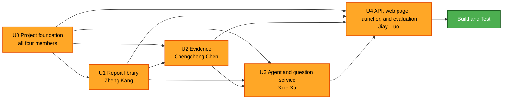

# Unit of Work Dependencies: ReportTrace

## 1. Rules

- A unit may depend only on units that come earlier in the construction order U0, U1, U2, U3, U4 (Q4). No unit depends on a later unit, so each unit can be designed, built, and tested completely before the next one starts.
- The component dependencies inside the units follow `component-dependency.md`. The unit boundaries do not add new dependencies.
- Once a unit is approved, the interfaces that later units use change only through the workflow.
- Each unit adds integration tests for its boundary with the units already built (Q5). Build and Test then runs all tests and adds the end-to-end tests.

## 2. Dependency Matrix

Read each row as "the row unit depends on the column unit". Legend: **D** = direct dependency; **-** = no dependency.

| Unit | U0 Foundation | U1 Library | U2 Evidence | U3 Agent and service | U4 API, page, evaluation |
| --- | --- | --- | --- | --- | --- |
| U0 Project foundation | - | - | - | - | - |
| U1 Report library | D | - | - | - | - |
| U2 Evidence | D | D | - | - | - |
| U3 Agent and question service | D | D | D | - | - |
| U4 API, web page, launcher, and evaluation | D | D | D | D | - |

## 3. What Each Unit Uses From Earlier Units

Items marked "T:" are used in tests only.

| Unit | Uses from U0 | Uses from U1 | Uses from U2 | Uses from U3 |
| --- | --- | --- | --- | --- |
| U1 | Domain types (`Company`, `Filing`, `FiscalYear`, `Passage`, `Figure`); `Settings`; `build_embeddings`; T: fake embeddings, sample report, `MockTransport` helpers | | | |
| U2 | Domain types (`Selection`, `Passage`, `Figure`, `Calculation`, check types); T: fake embeddings | `PassageIndex.search`, `PassageStore`, `FigureStore`; T: `FakePassageIndex`, small-library helper | | |
| U3 | Domain types (steps, events, `RunRecord`); `Settings`; `build_chat_model`; T: `FakeToolCallingModel` | `PassageIndex`, `PassageStore`, `FigureStore`; T: small-library helper | `ALL_TOOLS`, `AgentContext`, `EvidenceRecord`, `AgentAnswer`, `AnswerChecker` | |
| U4 | Domain types; `Settings`; `build_chat_model`, `build_embeddings`; T: `FakeToolCallingModel` | `open_library`, `CompanyStore`, `PassageStore`, `FigureStore`, `LibraryInfoStore`; T: small-library helper | `AnswerChecker` (to build the service) | `QuestionService`, `ConversationRegistry`, `RunLogWriter` (to build the service), the event types |

U4 also depends on U3 for the evaluation, which calls the `QuestionService` in-process (application design Q9).

## 4. Integration Tests at Each Boundary

| Unit | Boundary tested | Integration test |
| --- | --- | --- |
| U0 | None (first unit) | The Cornell API check, run by hand against the real API. It is not part of `uv run pytest`, because tests never use the network |
| U1 | U0 to U1 | `tests/integration/test_ingestion.py`: the whole ingestion runs on the sample report with `httpx.MockTransport` and fake embeddings. Then the stores read the companies, labels, sections, passages, neighbours, and figures back |
| U2 | U1 to U2 | `tests/integration/test_tools_on_library.py`: the tools run on the small library. The answer check then checks a sample `AgentAnswer` against the evidence record that the tools filled |
| U3 | U1 and U2 to U3 | `tests/integration/test_question_service.py`: the question service runs with `FakeToolCallingModel`, the real tools, the real check, and the small library. Scenarios: single year, comparison, tool error, tool-call limit, second attempt, follow-up, selection change, model failure |
| U4 | U1 and U3 to U4 | `tests/integration/test_api.py`: every endpoint, through `TestClient` with the real service and the fake model, including the streamed events and the error shape. `tests/ui/test_page_smoke.py`: the Streamlit `AppTest` smoke test. `tests/integration/test_evaluation_runner.py`: the runner on a few sample questions |
| Build and Test | All units | The full test suite with coverage. End-to-end checks of each story against all its acceptance criteria. The full evaluation run against the real model, by hand |

## 5. Diagram

Arrows point from a unit to the units that build on it, which is also the construction order.



**Text alternative.**

```text
Construction order: U0 -> U1 -> U2 -> U3 -> U4 -> Build and Test

U0 Project foundation (all four members)   used by U1, U2, U3, U4
U1 Report library (Zheng Kang)             uses U0;              used by U2, U3, U4
U2 Evidence (Chengcheng Chen)              uses U0, U1;          used by U3, U4
U3 Agent and question service (Xihe Xu)    uses U0, U1, U2;      used by U4
U4 API, web page, launcher, and evaluation (Jiayi Luo)
                                           uses U0, U1, U2, U3
Build and Test                             after U4
```

## 6. Critical Path and Risks

The construction order is one chain, so every unit is on the critical path. These points are the most likely to delay later units:

| Point | Unit | Why it matters | What the plan does |
| --- | --- | --- | --- |
| Cornell API embeddings and structured output | U0 | U1 cannot embed passages without embeddings. U3 is designed on structured output | The check is U0's first task. A failure goes back through the workflow before U1 starts (Q6) |
| 10-K parsing into items and notes | U1 | Every later unit's integration tests use the library. The demo needs all ten companies | Unrecognised text stays searchable. A company that cannot be parsed is replaced (FR-1.2) |
| Interfaces of `AgentAnswer` and `EvidenceRecord` | U2 | U3 builds the service on them, and U4 renders the answer from them | They are fixed in U2 Functional Design and change later only through the workflow |
| Tool-call limit and memory clean-up | U3 | The second attempt and FR-3.5 depend on them | Settled in U3 Functional Design (`application-design.md` Section 8, notes 2 and 3) |
| Time for U4 | U4 | U4 is the last unit and has the most acceptance criteria | US-4.2 (live steps, Should) is cut first. The evaluation set is written in parallel, so U4 builds only the script (Q8) |
