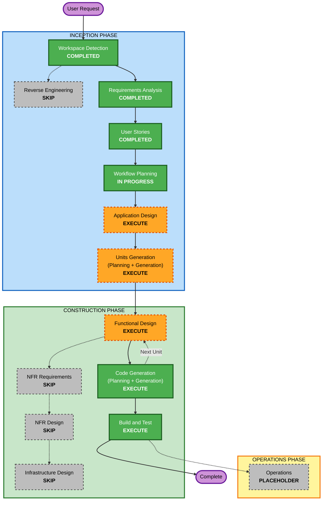

# Execution Plan: ReportTrace

## Context Loaded

| Source | Content used |
| --- | --- |
| Reverse engineering | None (greenfield project) |
| `requirements.md` | Intent analysis, FR-1.1 to FR-11.7, NFR-1 to NFR-8, derived rules D1 to D11, constraints, risks |
| `requirement-verification-questions.md`, `requirement-clarification-questions.md` | 26 answers and 5 clarification answers |
| `stories.md`, `personas.md` | 14 stories in eight epics, 3 personas, supporting requirements F1, F10, F11 |
| `vision.md`, `tech-env.md` | Construction window, team size, fixed technology stack and architecture rules |

## Detailed Analysis Summary

### Transformation Scope

Not applicable: greenfield project. Everything is new.

### Change Impact Assessment

| Impact area | Impact | Description |
| --- | --- | --- |
| User-facing changes | Yes | A new Streamlit page: selection panel, chat, agent steps, year comparison, figures, evidence cards, and gap list (US-2.1 to US-9.1) |
| Structural changes | Yes | A new system with fixed one-way layers (`ui` to `api` to `agent` to `tools` to `storage`), plus an ingestion script and an evaluation script (NFR-6.2) |
| Data model changes | Yes | New local stores: an SQLite file with companies, filings, passages, and financial figures, and a Chroma collection `passages` (FR-1.5, FR-1.8) |
| API changes | Yes | A new local FastAPI backend: library listing, question answering with step events, and evidence look-up (FR-7.5, NFR-5.1) |
| NFR impact | Yes | Speed targets, API usage limits, the security rules of `tech-env.md`, test coverage, and portability (NFR-1 to NFR-8) |

### Risk Assessment

- **Risk Level:** Medium. Many new components, and three significant unknowns: Cornell API embeddings are untested (Q18), the API quota is unknown (Q19), and 10-K layouts differ between companies, now with note-level sections (FR-1.6). Each unknown has a mitigation in `requirements.md` Section 13.
- **Rollback Complexity:** Easy. Greenfield code under Git, run only on the team's laptops. The library can be rebuilt with the ingestion script.
- **Testing Complexity:** Complex. An LLM agent is tested with a scripted fake model and fake embeddings. The `calculate` tool and the answer check need `hypothesis` property-based tests. The real-model evaluation is a separate, manual run (NFR-6.8, NFR-6.9, FR-11.4).

## Workflow Visualization

### Mermaid Diagram



Legend: green = completed or always executed; orange with dashed border = conditional stage that will execute; grey with dashed border = skipped stage or placeholder. Dotted arrows lead to skipped stages, or back to Functional Design for the next unit.

### Text Alternative

```text
Phase 1: INCEPTION
- Workspace Detection ...... COMPLETED
- Reverse Engineering ...... SKIP (greenfield)
- Requirements Analysis .... COMPLETED
- User Stories ............. COMPLETED
- Workflow Planning ........ IN PROGRESS
- Application Design ....... EXECUTE
- Units Generation ......... EXECUTE

Phase 2: CONSTRUCTION (repeated for each unit, then Build and Test once)
- Functional Design ........ EXECUTE
- NFR Requirements ......... SKIP
- NFR Design ............... SKIP
- Infrastructure Design .... SKIP
- Code Generation .......... EXECUTE (always)
- Build and Test ........... EXECUTE (always, after all units)

Phase 3: OPERATIONS
- Operations ............... PLACEHOLDER
```

## Phases to Execute

### 🔵 INCEPTION PHASE

- [x] Workspace Detection (COMPLETED)
- [x] Reverse Engineering (SKIPPED)
  - **Rationale:** Greenfield project with no existing code.
- [x] Requirements Analysis (COMPLETED, Comprehensive depth)
- [x] User Stories (COMPLETED: 3 personas, 14 stories)
- [x] Execution Plan (COMPLETED, approved 2026-11-20T07:40:10Z)
- [ ] Application Design - EXECUTE
  - **Rationale:** Every component is new. `tech-env.md` states that "Application Design decides the modules" and fixes only the layer order and the four tools. The components, their methods, and their dependencies still need to be defined. Examples: the ingestion pipeline, the passage and figure stores, the four tools and their shared formatting, the agent context and middleware, the structured answer that the answer check needs (`requirements.md` Section 12), the answer check, the API endpoints and their step events, the Streamlit page, the run log, and the evaluation script.
- [ ] Units Generation - EXECUTE
  - **Rationale:** The system has several modules that the four team members will build in parallel. During Construction each unit of work has one owner who reviews its code and tests (README collaboration plan). The units, their dependencies, and their story mapping must be fixed before Construction, together with a build order that follows the risk mitigation in `vision.md`: library, tools, agent, answer check, chatbot, comparison view, evaluation.

### 🟢 CONSTRUCTION PHASE

- [ ] Functional Design - EXECUTE (for each unit; detail adapts to the unit)
  - **Rationale:** The system has detailed business rules that must be designed before code. Examples: splitting passages and labelling sections and notes (FR-1.5, FR-1.6), mapping line items and choosing values (FR-1.8, FR-6.3, D1), the rounding rule (FR-6.6), the fixed operations of `calculate` (FR-6.4), quote and number matching (FR-8.2, FR-8.3), the evidence scope and the second attempt (FR-8.5, FR-8.6, D5), the neutral gap line (D4), and the evaluation metrics (FR-11.5, FR-11.6). A unit with little business logic gets a short design.
- [ ] NFR Requirements - SKIP
  - **Rationale:** The technology stack is fixed by `tech-env.md`, so no stack has to be selected. The non-functional requirements are already stated with measurable values in `requirements.md` Section 8. Examples: the speed targets, the 60-second timeout with 2 retries, the security rules, the 80% coverage target, and the platforms. Each unit's Functional Design and Code Generation plan checks the NFR IDs that apply to that unit.
- [ ] NFR Design - SKIP
  - **Rationale:** NFR Requirements is skipped. The NFR patterns are already prescribed by `tech-env.md`: model timeouts and retries, `ToolCallLimitMiddleware`, a `wrap_tool_call` middleware that returns tool errors, read-only SQLite with parameterised queries, `SecretStr` for the key, binding to `127.0.0.1`, and fakes in tests. Application Design places these patterns in components.
- [ ] Infrastructure Design - SKIP
  - **Rationale:** There is no cloud provider and no deployment (`tech-env.md`). The product is two local processes started by `uv run reporttrace`, with data in a local `data/` folder. All of this is already specified in `tech-env.md` and NFR-7.1.
- [ ] Code Generation - EXECUTE (ALWAYS)
  - **Rationale:** Implementation planning and code generation are needed for every unit, including the tests for that unit.
- [ ] Build and Test - EXECUTE (ALWAYS)
  - **Rationale:** Build, test, and verification are needed after all units: `uv run ruff check .`, `uv run mypy src`, `uv run pytest` with coverage, the Streamlit smoke test, and the instructions for the manual evaluation run.

### 🟡 OPERATIONS PHASE

- [ ] Operations - PLACEHOLDER
  - **Rationale:** Future deployment and monitoring workflows. ReportTrace is not deployed.

## Extension Compliance

All three extensions are switched off (`aidlc-state.md`, Extension Configuration). Their rules are not loaded or enforced in any stage. The Security section and the `hypothesis` tests of `tech-env.md` remain requirements (NFR-3, NFR-6.8).

| Extension | Status in this plan |
| --- | --- |
| Security Baseline | N/A (disabled at Requirements Analysis) |
| Property-Based Testing | N/A (disabled at Requirements Analysis) |
| Resiliency Baseline | N/A (disabled at Requirements Analysis) |

## Package Change Sequence

Not applicable: greenfield project. Units Generation sets the order in which units are built.

## Estimated Timeline

- **Total stages:** 13 stages and 1 placeholder. 9 stages execute (Workspace Detection, Requirements Analysis, User Stories, Workflow Planning, Application Design, Units Generation, Functional Design, Code Generation, Build and Test). 4 stages are skipped (Reverse Engineering, NFR Requirements, NFR Design, Infrastructure Design).
- **Inception:** Application Design and Units Generation are completed before Construction starts on November 25, 2026.
- **Construction:** November 25 to December 16, 2026 (`vision.md`). Functional Design and Code Generation run for each unit, and Build and Test runs once after all units. If time is short, the live display of agent steps (US-4.2) is cut first.

## Success Criteria

- **Primary goal:** The MVP objective in `vision.md`: an LLM agent answers open questions about a company's annual reports, for one year or across several years, and every quote and figure in an answer can be traced to its source.
- **Key deliverables:**
  - application code in the `src/reporttrace` package at the workspace root;
  - unit tests, integration tests, and a Streamlit smoke test;
  - the ingestion script and a demo library of ten companies with three fiscal years each;
  - the evaluation set of at least 30 questions, the evaluation script, and a results report;
  - the AI-DLC artifacts in `aidlc-docs/`.
- **Quality gates:**
  - each stage is explicitly approved by the team before the next one starts;
  - `uv run ruff check .`, `uv run mypy src`, and `uv run pytest` pass before each commit (NFR-6.10);
  - line coverage is at least 80% for `tools`, `agent`, `storage`, and `ingestion` (NFR-6.7);
  - the acceptance criteria of the 14 stories in `stories.md` are met;
  - the final evaluation run reports all six success metrics; a missed target is explained (FR-11.7).
